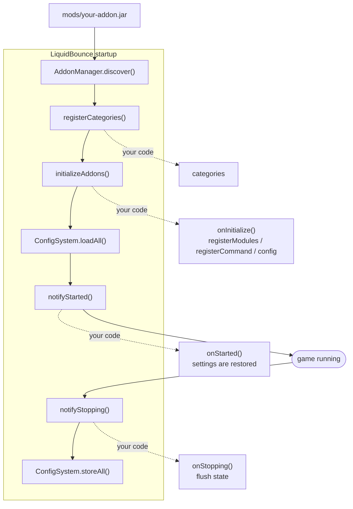

# LiquidBounce Add-on Template

A starting point for a [LiquidBounce](https://github.com/CCBlueX/LiquidBounce) add-on.



## Requirements

- JDK 25
- A LiquidBounce build to compile against (a published snapshot, or one you built yourself)

## Getting started

1. Click **Use this template** on GitHub, or `git clone --depth 1` this repository.
2. Rename things away from the example. There are eight places:

   | File | What to change |
   |---|---|
   | `settings.gradle.kts` | `rootProject.name` |
   | `gradle.properties` | `maven_group`, `archives_base_name` |
   | `src/main/resources/fabric.mod.json` | `id`, `name`, `description`, `authors`, the entrypoint class |
   | `src/main/resources/example-addon.mixins.json` | filename, and the `package` |
   | `src/main/resources/example-addon.accesswidener` | filename (and `loom.accessWidenerPath` in `build.gradle.kts`) |
   | `src/main/resources/resources/example-addon/` | folder name, which must match your add-on id, and the `icon` path |
   | `src/main/kotlin/com/example/addon/` | package name |

3. `./gradlew build`, then drop `build/libs/<your-addon>.jar` into your `mods/` folder next to
   LiquidBounce.
4. In game, `.addon list` should show it, and `.example` should answer.

## Targeting a LiquidBounce version

`gradle/libs.versions.toml`:

```toml
liquidbounce = "0.41.0+26.3"
```

- `<version>+<mc>` for a release, from `maven.ccbluex.net/releases`
- `<version>+<mc>-SNAPSHOT` for the moving nextgen build, from `maven.ccbluex.net/snapshots`
- `<version>+<mc>-<sha>-SNAPSHOT` to pin one commit

To build against a local client, run `./gradlew publishToMavenLocal` in a LiquidBounce checkout;
`mavenLocal()` is already in this template's repositories.

**Do not add a `mappings(...)` line.** LiquidBounce declares none either, and Loom defaults to
Mojang official mappings for this Minecraft version. A different mapping set produces an add-on that
compiles and then fails on every Minecraft call.

## DoubleClicks

`DoubleClicks` adds **1–3** follow-up clicks to each real click (`ExtraClicks`, default 1): the left
button (attack) and, with `RightClick` (default on), the right button (use/place) as well.
`Delay` is at least one game tick (default 1), so follow-ups are not sent in the original click's
input batch. The queue holds at most three follow-ups; very fast clicks can therefore drop some
rather than leave a long backlog. It works on the ground and in the air, and also follows rebound
attack keys or clicks queued by another clicker.

Only a follow-up whose crosshair is still on an entity repeats the vanilla attack. On a block, while
mining, on air, or while Minecraft's miss cooldown blocks attacks, the follow-up is the swing
animation/packet **only**: it does not start, stop, or accelerate block digging, does not set a new
miss cooldown and does not damage an entity. Clicks that vanilla itself swallowed during the miss
cooldown are not copied at all. Opening a screen, changing worlds, or disabling the module clears
pending clicks. Clicks queued by another clicker (LiquidBounce's AutoClicker) are followed too,
so its CPS doubles as well. Other modules and the server can still affect clicks, and no setting
guarantees that an anti-cheat will not flag them.

The right button works the same way: the follow-up is the vanilla use path, so it can place the next
block, throw the next pearl or interact again. Only **one follow-up leaves per tick in total**, left
or right, and the left queue is drained first; with three left follow-ups still pending a right
click can therefore wait a tick or two longer. It is dropped (not
turned into an animation) while a block is being mined, while an item is already in use and while
the hands are busy in a vehicle, because vanilla refuses a use in exactly those cases. Consumables
with a use duration (food, potions, bows) are therefore not doubled: the first use already put the
item in use. Turn `RightClick` off to leave the right button alone.

## Clicks that never become block digs

Everything the add-on clicks goes through the vanilla input path, so a click is resolved against the
crosshair that exists **at that moment**. A click that lands on a block becomes
`START_DESTROY_BLOCK` — a block-dig action the player never asked for, and exactly what a nuker check
counts (Vulcan's `BadPackets (Nuker)` among them). Every module that can queue a click therefore
refuses a crosshair it cannot answer safely:

| Module | Rule |
|---|---|
| `DoubleClicks` | a follow-up repeats `startAttack` only on an entity; block, air and the miss cooldown get a swing |
| `TriggerBotPlus` | `PrePress = Key` queues the real click only on air; on a block it swings the arm instead |
| `HitFlick` | the click is queued only after refreshing the pick: never on a block, never while mining, never when the crosshair is no longer on the flicked target |

None of the modules sends a destroy action of its own, and none of them removes vanilla's miss
cooldown to hide a click. What the rest of the chain does is still out of reach: another client
module (LiquidBounce's own AutoClicker or AutoBreak), the server's own view of a held button, and
latency all shape what arrives at the anti-cheat, so no setting here can promise a clean session.

## Two profiles, one click

The two settings this add-on is meant to be run on are presets, not a list of numbers to type:
**`Preset = Profile A`** (the default) and **`Preset = Profile B`** in the Aimassist. They are
declared once in `AimValues.dailyProfile`, so B is literally A with the engine swapped — they
cannot drift apart.

| | Profile A (default) | Profile B |
|---|---|---|
| Engine | `Math` — the curve | `AI` — LiquidBounce's trained combat model |
| `AIYawMultiplier` / `AICorrection` | 1.2 / 10 | 1.2 / 10 |
| everything else | the same | the same |

Both write the whole *behaviour* of the module:

| Knob | Value | Why |
|---|---|---|
| `OnlyOnCrosshair` | on | the assist may only help a crosshair that is already on the hitbox |
| `TurnCheck` | on | it never fights the player's own turn |
| `Mode` / `Friction` | Both / 20 | the damping rides the vanilla cursor path, no rotation of its own |
| `DeadZone` | 0.4° | fewer corrections, and never under one mouse count |
| `Smoothing` / `PitchAssist` | Bezier / 50 | a human tracks yaw better than pitch |
| `Predict` | 0.05 | far less "telepathic" lead than the old default |
| `ReactionDelay` / `Random` / `FadeIn` | 200 / 100 / 300 ms | the first correction of an engagement is not instant |
| `IdleChance` | 15% | a pull that never stops is a machine |
| `MouseNoise` / `Overshoot` / `StrengthSpread` | 2 / 10 / 20 | the hand on the mouse lattice |
| `PatternGuard` | on | no window of two to six steps repeats three times |
| `Silent` | **off** | the server sees what the player sees: nothing to call a post rotation |
| `AttackSync` | on | a click never leaves before the rotation is on the entity |

`Range`, `Fov`, `Strength` and `MaxSpeed` are **not** part of either profile: they are the four
numbers that describe the player's own aim, and the preset leaves them exactly where they are. If
you pick one of the two while `Strength`/`MaxSpeed` are above what a nudge can be (50% / 12°), the
module says so in chat once instead of quietly pretending.

## A rotation that never repeats itself

An anti-cheat cannot see *why* a rotation moved; it can only see the numbers, over and over.
`Killaura (Pattern)` is the check that reads them as a sequence, and the Aimassist is the worst
case for it of everything in this add-on: an assist holds the crosshair on the same target for
seconds, and while the player keeps still the steps in the packets are the module's alone — no
hand mixed in. A slow pull through a mouse-count lattice then emits the same couple of numbers on
every tick, which is exactly the shape the check is built to find.

Three rules in `AimassistCore` / `MousePatternGuard` (shared with `AimbotAI`, `FireballDeflect`
and `FireballJumpAI`) make sure the sequence never settles:

| Rule | What it removes |
|---|---|
| the dead zone is never narrower than one mouse count | a correction the mouse cannot represent is rounded to `0` and asked again next tick: the `+1, -1, +1, -1` metronome |
| a step that rounds to nothing is not sent with noise on top | the tremble a crosshair gets when it is already on the target |
| no cycle of two to six steps may repeat three times (`PatternGuard`) | the same handful of numbers coming back in the same order, whatever produced them |

The third one is the only part that looks at the sequence instead of a single step. When a step
would close a cycle it is nudged by one or two counts — never across the goal, so the aim keeps
going where it was going — and the count is written down as a debt, paid back on a later step in
the same direction, so the path still adds up to what the engine planned. A hand at rest (`0, 0`)
is never touched: resting is not a pattern. `Debug` prints the repairs next to the step
(`guard=N`) so the switch can be checked against the anti-cheat log.

## What the example covers

- `ExampleAddon`, the entrypoint and its lifecycle hooks
- `ExampleCategories`, a custom ClickGUI category
- `modules/ModuleExample`, a `ClientModule` with settings and a tick handler
- `commands/CommandExample`, a Brigadier command
- `mixin/MixinExampleTitleScreen`, a Mixin into a vanilla class
- `resources/example-addon/lang/en_us.json`, translations merged into the client's language files

Client translation keys always win on collision, so an add-on cannot redefine a built-in string.

## Files your add-on ships

Everything goes into `src/main/resources/resources/<your-addon-id>/`: translations under `lang/`, the mod
icon, ClickGUI category icons (`ModuleCategory("Name", Identifier.fromNamespaceAndPath("<your-addon-id>", "clickgui/name.svg"))`).
Never use `assets/<your-addon-id>/`. Fabric registers every mod jar as a resource pack, so anything under
`assets/` becomes part of Minecraft's resources and could theoretically be used to detect LiquidBounce and
the add-on. The client reads its own `resources/` folder from the jar directly, which nothing else sees.

Everything marked `@AddonApi` in the client is stable between releases; the rest may change. For a
larger example, Kotlin and Java side by side and game tested, see
[LiquidBounce-Addon-Extras](https://github.com/CCBlueX/LiquidBounce-Addon-Extras).

## Publishing

A GitHub release pushes the jar to the LiquidBounce Marketplace. Create the add-on and an API token at
[liquidbounce.net/account/resources](https://liquidbounce.net/account/resources), then set both on the
repository under Settings, Secrets and variables, Actions:

| Kind     | Name                  | Value                              |
|----------|-----------------------|------------------------------------|
| Variable | `MARKETPLACE_ITEM_ID` | the ID shown next to your add-on   |
| Secret   | `API_TOKEN`           | the token, it is only shown once   |

The build versions the add-on as `<mod_version>+<minecraft>`, e.g. `1.0.0+26.3`, so one version can be
released for several Minecraft versions. Tag the release with that version, `v1.0.0+26.3`: the tag becomes the
version on the Marketplace, the release notes its changelog, and the release fails when the tag and the jar
differ. Pre-releases are skipped. Uploads wait for review before clients see them, unless
the account is a trusted publisher.

## License

This project is subject to the [GNU General Public License v3.0](https://www.gnu.org/licenses/gpl-3.0.en.html). This
does only apply for source code located directly in this clean repository. During the development and compilation
process, additional source code may be used to which we have obtained no rights. Such code is not covered by the GPL
license.

For those who are unfamiliar with the license, here is a summary of its main points. This is by no means legal advice
nor legally binding.

*Actions that you are allowed to do:*

- Use
- Share
- Modify

*If you do decide to use ANY code from the source:*

- **You must disclose the source code of your modified work and the source code you took from this project. This means
  you are not allowed to use code from this project (even partially) in a closed-source (or even obfuscated)
  application.**
- **Your modified application must also be licensed under the GPL**
